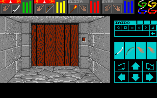
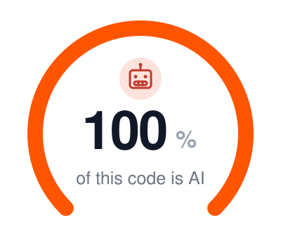

# Dungeon Master for macOS and Windows

A native C11/SDL3 port of **Dungeon Master v3.60** and **Chaos Strikes Back** for the Amiga. It runs on macOS
(Apple Silicon) and Windows (x86-64).



The port is a reimplementation, not an emulator. It is built from its own Ghidra decompilation of the original
Amiga program. The game rules follow the decompiled code exactly, and differential tests compare the port with the
original program in a 68000 emulator. The Amiga technical layer (copper, blitter, disk loader) is not reproduced.

This repository contains no game files. You need your own Amiga disk images.

## What you get

- The complete Dungeon Master and Chaos Strikes Back, from the Hall of Champions to the end.
- Three modes:
  - **Vanilla:** the original game.
  - **Advanced:** the original game with extras: an automap, an options menu (sound and music volume, music
    choice, upscale filter), 8 save slots, quick save and quick load, a cheat screen, WASD keys, up to 8 sounds at
    once, the FM-Towns and Super NES soundtracks, and a direct start of Chaos Strikes Back from the prison stairs.
  - **LLM (turn-based):** a program or a language model plays the game through a Unix socket; the game time stands
    still between turns. macOS only.
- Pixel-art upscale filters (`scale2x`, `scale3x`) and a window that scales with its size.

## System requirements

- macOS: a current macOS on Apple Silicon.
- Windows: Windows 10 or later, x86-64.
- Your own Amiga disk images; see [Get the game data](#get-the-game-data).

The Windows build is tested under Wine only, not on a real Windows.

## Get the game data

You need the Amiga disk images (`.adf`):

- `Dungeon Master v3.60.adf` (one disk).
- Optional: `Chaos Strikes Back (FTL) A.adf` and `Chaos Strikes Back (FTL) B.adf`.

Disks of other versions (DOS, Atari ST, other Amiga versions) do not work. At the first start the game extracts
the disks in the current folder; see [Run the game](docs/manual.md#run-the-game) in the player manual.

## Play

### From a release

1. Download `DungeonMaster.zip` (macOS) or `DungeonMaster-win.zip` (Windows) from the releases and unpack it.
2. Copy your `.adf` disk images into the unpacked folder.
3. macOS: open Terminal in the folder, remove the quarantine, and start the game:

   ```sh
   xattr -d com.apple.quarantine dm "Dungeon Master.command" libSDL3.0.dylib
   ```

   Then double-click `Dungeon Master.command`.

4. Windows: double-click `dm.exe`. When Windows warns about an unknown publisher, click "More info", then
   "Run anyway".

### From the source

```sh
brew install sdl3
uv sync
make
build/dm
```

Put the `.adf` disk images in the folder where you start `build/dm`.

### First steps

1. Select the adventure (DUNGEON MASTER or CHAOS STRIKES BACK) and the mode (VANILLA, ADVANCED, or LLM).
2. Dungeon Master: click ENTER for a new game or RESUME for a saved game. Chaos Strikes Back: NEW ADVENTURE or
   RESUME.
3. Recruit champions at the mirrors: click a mirror, then RESURRECT or REINCARNATE.

The controls are the controls of the Amiga original: the mouse, the cursor keys or the keypad to move, Delete and
Insert to turn, F1 to F4 for the inventories, Ctrl+S to save. The advanced mode adds W, A, S, D, Q, E, M or Tab
(automap), Escape (options), C (cheats), F5 and F9 (quick save and quick load). The full list is in the
[player manual](docs/manual.md#controls).

### Options

`build/dm --help` prints the options. The [player manual](docs/manual.md#options) describes each option.

The saved games go to `game/` (Dungeon Master) and `game-csb/` (Chaos Strikes Back), or to the folder of
`--saves`. The save files have the format of the Amiga original.

### Let an LLM play

Start the game in the turn-based mode with a control socket, then send requests with `dm-play` or connect Claude
Code through the MCP server `dm-mcp`:

```sh
build/dm --mode turnbased --control /tmp/dm.sock
DM_CONTROL=/tmp/dm.sock uv run dm-play --brief get_state
DM_CONTROL=/tmp/dm.sock uv run dm-play act move_forward
```

The protocol, the actions, and the setup are in [LLM mode](docs/llm/llm-mode.md).

## Develop

```sh
make            # the game and the test library, 0 warnings
make test       # the test suite (pytest, in parallel)
make check      # format, coding standard, and the suite
make windows    # build/dm.exe with MinGW-w64
```

The build, the tests, and the release are in [Development](docs/development.md).

## How it was made

The port was written with Claude (Claude Code).

1. Decompile: Ghidra decompiles the FTL code modules of the Amiga v3.60 disk to C
   ([Decompiling](docs/decompiling.md)). The symbol tables in `docs/reference/` name the functions and the globals.
2. Port: the game rules are written again in C11 from this decompilation only. No code of another port is used.
3. Check against the original: the differential tests run a function of the original program in a 68000 emulator
   and the same function of the port with the same input, then compare the state. Golden snapshots keep the save
   file, the dungeon view, and the game rules.
4. Clean up: several passes made the code clear, each without a change of game behavior: a clean-code pass (named
   constants, typed accessors, the game rules out of the user interface), a final refactor into five layers, a
   coding standard with a check per rule, and an audit of the tests.

## Documentation

- [Player manual](docs/manual.md): run, options, controls, modes, saves
- [Development](docs/development.md): build, tests, release
- [Changes](CHANGELOG.md)
- [Architecture](docs/architecture.md) and [coding standard](docs/coding-standard.md)
- [Decompiling](docs/decompiling.md): Ghidra tooling
- Formats: [FTL](docs/formats/ftl.md), [Dungeon.DAT](docs/formats/dungeon.md),
  [save file](docs/formats/save.md)
- [Rules](docs/rules/game-state.md) of the game engine
- [Chaos Strikes Back](docs/csb/data.md)
- [LLM mode](docs/llm/llm-mode.md), [LLM runs](docs/llm/llm-runs.md), and [LLM playbook](docs/llm/llm-playbook.md)
- [Reference](docs/reference/kaos-map.md): the KAOS map and the symbol notes

## Acknowledgements

- [SDL3](https://github.com/libsdl-org/SDL): the window, the input events, and the audio output.
- [dr_mp3](https://github.com/mackron/dr_libs) by David Reid (`src/third_party/dr_mp3/`): the MP3 decoder of the music.
- amitools: the disk extraction of `dm-extract` and the reference for the ADF reader tests.
- machine68k: the 68000 emulator that runs the original program in the differential tests.
- ReDMCSB: many function and structure names of the decompilation follow its source files.
- dmcsb: the reference for the `Dungeon.DAT` checks in the tests.

## License

The code is GPL-3.0-or-later ([LICENSE](LICENSE)). Dungeon Master and Chaos Strikes Back are games of FTL Games
(Software Heaven). This project is not affiliated with them. The game data is not included and is not covered by
this license.

<p align="center"></p>
