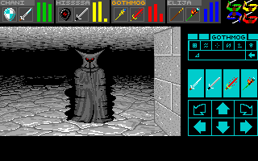

# DMMac: Dungeon Master for macOS and Windows

DMMac is a native C11 and SDL3 port of the Amiga versions of **Dungeon Master v3.60** and **Chaos Strikes Back**
for macOS (Apple Silicon) and Windows (x86-64).

<p align="center">
  
  
</p>

This repository contains no game data. You must provide your own Amiga disk images (`.adf`): Dungeon Master
v3.60 (1 disk) and optionally Chaos Strikes Back (disks A and B). DOS, Atari ST, and other Amiga releases are
not supported. The game identifies a disk by its content, not by its file name.

## Features

- **Full campaigns:** Both Dungeon Master and Chaos Strikes Back are playable to the end.
- **Vanilla mode:** The original rules, timing, and interface.
- **Advanced mode:** Automap, in-game options menu (volume, music, upscale filter), 8 save slots, quick save/load,
  cheat screen, WASD movement, 8 simultaneous sounds, FM-Towns and Super NES soundtracks, and direct entry to
  Chaos Strikes Back from the prison stairs.
- **LLM mode (macOS only, `--mode turnbased`):** A program plays the game over a Unix socket, one turn per request.
- **Display scaling:** Window resizing with the `scale2x` and `scale3x` pixel-art filters.

## Play

Download the [latest release](https://github.com/peterkmet/dmmac/releases/latest) (`DMMac-macos-arm64.zip` or
`DMMac-windows-x64.zip`), extract it, and copy your `.adf` disk images into the folder.

- **macOS:** Remove the quarantine attribute and launch `Dungeon Master.command` (or double-click it in
  Finder):

  ```sh
  xattr -d com.apple.quarantine dm "Dungeon Master.command" libSDL3.0.dylib
  open "Dungeon Master.command"
  ```

- **Windows 10+:** Run `dm.exe`. If Windows SmartScreen warns about an unknown publisher, select "More info",
  then "Run anyway".

On first launch, the game extracts the disk images into `game/` and `game-csb/`. Each adventure keeps its
saves in its own folder, in the original Amiga format.

Keys of the advanced mode (in the dungeon view):

| Key | Action |
|---|---|
| W, A, S, D, Q, E | Move and turn |
| M, Tab | Automap |
| Escape | Options menu (volume, music, upscale filter) |
| C | Cheat screen |
| F5, F9 | Quick save, quick load |
| Ctrl+S | Save dialog with the 8 slots |

See the [Player manual](docs/manual.md) for all controls, game modes, and configuration.

## Let an LLM play

```sh
build/dm --mode turnbased --control /tmp/dm.sock
DM_CONTROL=/tmp/dm.sock uv run dm-play --brief get_state
DM_CONTROL=/tmp/dm.sock uv run dm-play act move_forward
```

The `dm-mcp` server exposes the control socket over the Model Context Protocol (MCP) for clients such as Claude
Code. [LLM mode: turn-based play over MCP](docs/llm/llm-mode.md) has the protocol, the actions, and the setup. [LLM runs](docs/llm/llm-runs.md)
describes playthroughs with a coordinator and player agents.

## Build

```sh
brew install sdl3
uv sync
make            # Build build/dm and the test library
make test       # Run the test suite
make check      # Check formatting, coding standard, and tests
make windows    # Cross-compile build/dm.exe with MinGW-w64
```

Run `build/dm` from the folder with your `.adf` images. See [Development](docs/development.md) for
build and release workflows, [Architecture](docs/architecture.md) and [Coding standard](docs/coding-standard.md)
for codebase structure, and [Changelog](CHANGELOG.md) for release history.

## Engineering

Claude Code built the port in four stages:

1. **Decompilation:** Ghidra decompiled the 68000 FTL modules to C ([Decompiling](docs/decompiling.md)). The
   symbol tables in `docs/reference/` name the functions and globals.
2. **Reimplementation:** Claude Code rewrote the game logic in C11 from the decompilation alone, without code
   from other ports.
3. **Differential verification:** Automated tests execute ported C functions alongside the original 68000 code
   in an emulator using identical inputs and compare the resulting state. Golden snapshots validate save files,
   viewport rendering, and game mechanics.
4. **Refactoring:** Later passes added named constants, typed accessors, the five layers, and the automated
   coding-standard checks. The game behavior did not change.

[ReDMCSB](http://dmweb.free.fr/community/redmcsb/) is Christophe Fontanel's reconstruction of the original 68000
source. It compiles to bit-identical Amiga and Atari ST binaries. DMMac takes only the function and structure
names from ReDMCSB, which keeps the two code bases easy to compare.

More: [FTL module format](docs/formats/ftl.md), [Game state](docs/rules/game-state.md),
[Chaos Strikes Back data files](docs/csb/data.md), [KAOS module map](docs/reference/kaos-map.md).

## Acknowledgements

- [SDL3](https://github.com/libsdl-org/SDL) — windowing, input, and audio output.
- [dr_mp3](https://github.com/mackron/dr_libs) by David Reid — MP3 audio decoding.
- [amitools](https://github.com/cnvogelg/amitools) — ADF image extraction and reference implementation for ADF
  reader tests.
- [machine68k](https://github.com/cnvogelg/machine68k) — 68000 CPU emulation for differential tests.
- [ReDMCSB](http://dmweb.free.fr/community/redmcsb/) by Christophe Fontanel — symbol and structure naming
  reference.
- [dmcsb](https://codeberg.org/CyCl0ne/DungeonMasterTools) by Cycl0ne — reference validator for `Dungeon.DAT`
  test checks.

## License

GPL-3.0-or-later ([LICENSE](LICENSE)). Dungeon Master and Chaos Strikes Back are properties of FTL Games. This
project is not affiliated with or endorsed by the rights holders. Original game data is not included and is not
covered by this license.
